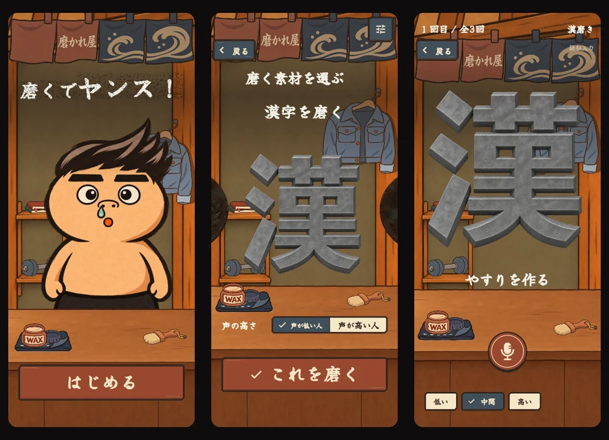

# 磨くでヤンス！

## 概要

「あー」と声を伸ばすと、その高さに合った紙やすりが一枚、目の前に落ちてきます。
スマホをやすりに見立てて前後に動かすと、緑青に覆われたメダルから金色がのぞきます。
もう一つの素材は「漢」の一文字。うまく磨けば段位と称号がもらえますが、欲張って削りすぎると、その場で真っ二つに割れます。

## メンバーと各担当範囲

| 名前 | 担当範囲 |
| --- | --- |
| 北林瑞生 | 声の高さとスマホの往復の検出、振動の調整、ゲーム全体の組み込み |
| 嶋本渚沙 | 素材選択や研磨の画面、削り粉・メダルの刻印・「漢」が割れる演出 |
| 松本吏功 | アイデア出し、発表スライドの制作、発表原稿の考案 |
| 網田真那 | 発表スライドの制作 |
| 永松優空 | アイデア出し、発表スライドと原稿の作成 |

## 使用言語と動作環境

- **言語**　Dart 3.11.3（ゲームと画面）、Kotlin 2.2.20（Androidのマイク・センサー・振動）
- **Android版**　Flutter 3.41.5。開発中の実機検証には Xiaomi REDMI Note 15 5G（Android 15）を使いました。スマホを机と平行に持ち、「磨け！」の合図で前後に動かして遊びます。[実機の計測記録](docs/validation.md)
- **PCでの試遊**　Chromeで遊べます。声の高さをボタンで選んでマイクを押し、「磨け！」が出たら「こする」を押すと、1往復ずつ磨けます。

**手元で遊ぶには**、GitHub ActionsからPC用の `migaku-web` または実機用の `migaku-android` をダウンロードしてください。PCはPython 3とChrome、Androidは同梱のAPKで始められます。ソースを使う場合は本選ブランチ `honsen` を取得します。[ダウンロードから最初のひと磨きまで](docs/development.md)

## 利用しているライブラリ・ミドルウェアとその利用目的

| 名前 | 使いどころ |
| --- | --- |
| Flutter / `flutter_localizations` | 素材選びから仕上げまでを描画し、設定やダイアログも日本語で表示します。 |
| Flutter の `MethodChannel` / `EventChannel` | FlutterからAndroidに採音や振動を頼み、押し始めや往復の通知をゲームに返します。 |
| Android SDK の `AudioRecord`・`SensorManager`・`Vibrator` | マイクの音を取り込み、加速度から手の動きを読み取り、紙やすりの手触りを振動で作ります。 |
| `flutter_test` | 声の高さの境目、やすりごとの削れ方、磨きすぎた瞬間の終了、仕上げの指操作を確かめました。 |

## 利用しているサービスとその利用目的

- **GitHub / GitHub Actions**　チームの変更をプルリクエストで持ち寄り、テストを通したAndroid版とWeb版を試遊用に配布します。
- **プレイ中の通信**　声の高さの判定も、動きの計測も端末内で行います。Android版はインストール後、オフラインで最後まで遊べます。

## 利用している生成AIサービスとその利用目的

- **OpenAI Codex**　提出資料の整理、別PCでの起動手順の作成と検証に使いました。
- **Claude Code**　素材を回して選ぶ画面や削り粉の動き、「漢」の結果演出を実装するときに使いました。
- **OpenAI ImageGen**　チームで用意したヤンスの絵をもとに、店ののれん、木のカウンター、手元の刷毛などを制作しました。ヤンスの髪先や足の間から店内が見えるよう、タイトル用の絵の背景を抜く作業にも使いました。[素材の制作記録](docs/assets.md)

## 技術的に工夫した点・苦労した点

### 工夫した点

- **自分の声を一枚のやすりにする。** マイクで約1.2秒の声を拾い、安定した音の高さから粗目・中目・細目を決めます。低い声の人も高い声の人も三つの目を使い分けられるよう、最初に声域を選べます。測った周波数は紙やすりの表に「100 Hz」のように刷りました。
- **手の動きに合わせて、見えるものと触れるものを変える。** 押し始めに削り粉が飛び、手が滑っている間はスマホが震え、ひと往復すると素材が削れます。金色に仕上がったメダルの箔は、最後に指でこすったところだけ剥がれます。何度かなぞるうちに「最優秀賞」の文字が読めます。[メダルの仕上げ](docs/images/medal-scratch.webp)

### 苦労した点

- **ゆっくり磨くと、振動が後からついてくる。** 実機で試すと、手がすでに折り返す頃にスマホが震えることがありました。そこで実機の加速度を記録し、同じ動きを何度も再生して、滑っている途中で振動が始まるように調整しました。9 cmを0.6秒かけて押し、端で一度止める模擬試験では、停止後に最長184ミリ秒残っていた振動指令がなくなりました。[調整前後の波形](docs/images/slow-slide-timing.png)
- **スマホ自身の振動も、加速度センサーに届く。** 手を止めたまま振動させたときの波形をREDMIで記録し、手で押し引きしたときの波形と見比べました。調整後の判定で静止中の記録10.4秒分を再生したところ、モーターが動いている間も往復の誤加算は0回でした。[実機での計測方法](docs/device_trials.md)・[検証結果](docs/validation.md)

[ゲームの設計](docs/app_design.md)・[コードの構成](docs/project_structure.md)・[共同開発の担当とPRの宛先](docs/handoff.md)
