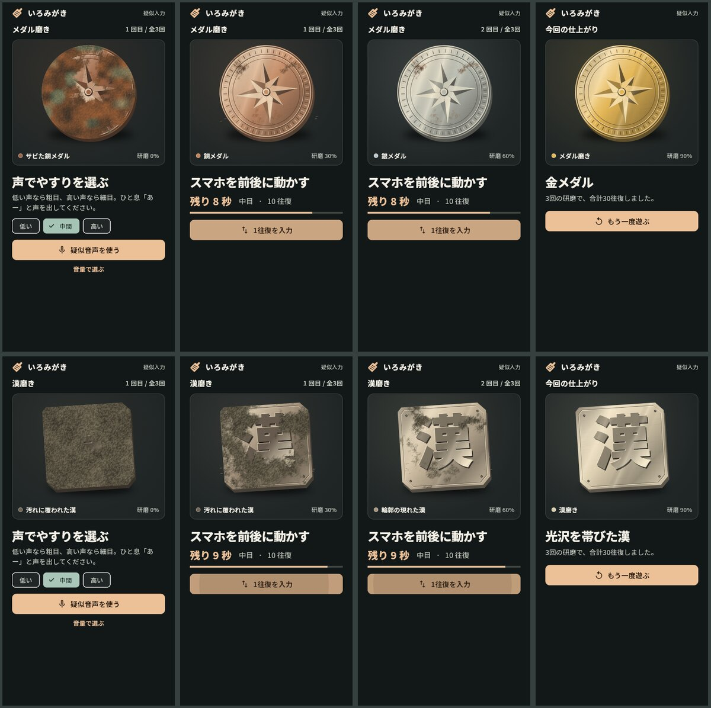

# 本選アプリの検証記録

## 細かい押し引きと中速・金の仕上げ（2026-11-22）

登録REDMIで重力込みの加速度を2組収録し、プレイヤーが指定した2組目を調整と比較に使った。各ファイルは3秒静止＋10秒往復。細かい動きは775点、中速は781点、サンプル間隔の中央値はどちらも16.7 ms。手で数えた往復数・実際の折り返し・振動を感じた時刻は未記録。

| 同じ加速度を本編の判定に再入力 | 指令が出た推定片道（旧 → 新） | 10秒間の振動開始指令（旧 → 新） |
|---|---:|---:|
| 指2本幅で細かく往復 | 48/68 → 57/68 | 61 → 72 |
| 手のひら幅で中速 | 22/29 → 29/29 | 28 → 38 |

粗目・研磨率0%で比較。片道は水平加速度を0.5〜10 Hzの範囲で積分し、主な運動方向の推定速度が反転する位置で区切った。両端の不安定な区間を除き、4.4秒以降、記録終了1.4秒前までの60〜1300 msでピーク速度0.15 m/s超の区間を集計。10秒全体のゲーム側の確定往復は細かい動き25 → 25、中速21 → 19。細かい動きの指令長中央値は80 → 26.5 ms。端末に実際に振動を出した長さや知覚の時間はこの再生からは測れない。

- **既存の実測を再生**。別に保存した低速テイクの指令ありは13/16片道で維持。高速は33/40 → 39/40。静止記録とモーターのみの記録は、接触・振動開始指令・往復の誤検出が各0件。
- **折り返しが既知の模擬入力**。片道1 cm・185 ms、2 cm・350 ms、3.5 cm・500 msの3条件を60/100 Hzで比較。いずれも14片道中、修正前0件、修正後14件で振動指令が出た。
- **画面と疑似入力**。Windows Chromeで中央の「110 Hz／粗目のやすり」、紙の着地、メダル上の「磨く！」、研磨開始時の「磨け」、削り粉を目視。Flutterでは両素材の3ラウンド、無音時の採り直し、音量判定、金ピカの仕上がり、再挑戦を含む全19テストが成功。[実際の4画面](images/polishing-flow.webp)・[REDMIで同じ動作を比較する手順](device_trials.md#細かい動きと中速を再録する)

## 低速で滑らせたときの振動の位置（2026-11-22）

プレイヤーから「ゆっくり滑らせると折り返しで振動が来る」と報告があった。試験時に登録REDMIに入っていたAPKは速度研磨版（SHA-256先頭 `f3291822`）。

**実機を机に置いた試験**。Androidの標準コマンドから150 msの振動を5回指令し、OSの記録と、Chromeの加速度通知を同じ端末の時計で比較した。

| 受付からの時間 | 1回目 | 2回目 | 3回目 | 4回目 | 5回目 |
|---|---:|---:|---:|---:|---:|
| OSが記録した振動開始 | 12 ms | 2 ms | 3 ms | 4 ms | 4 ms |
| 揺れが静止時の最大値を初めて超えた加速度通知 | 117 ms | 97 ms | 156 ms | 162 ms | 167 ms |

加速度は365点、サンプル間隔の中央値は17.4 ms。各回の直前に軸ごとの中央値を取り、そこからの3軸の差の大きさを計算した。5回分の静止118点の最大は0.1414 m/s²。2行目はセンサー通知が届いた時刻で、机の材質・通知頻度・数値の刻みの影響を含む。手に持ったときの知覚開始は別に確認する。[実機で押し・引きを比較する手順](device_trials.md#ゆっくりした折り返しのずれを確かめる)

| 確認方法 | 修正前 → 修正後 |
|---|---|
| 模擬入力。9 cmを600 msで押し引きし、端で200 ms止める（60 Hz）。最初の1往復を除く14片道で比較 | 振動指令が出た片道は4 → 14。指令が出た片道の開始中央値は583 → 100 ms。端で静止してからの振動指令は最長184 → 0 ms。[押し・引きと振動の比較図](images/slow-slide-timing.png) |
| 回帰テスト。同じ距離・時間で60/100 Hz、急に押し出す動きと滑らかに押し出す動きの4条件 | 修正後は開始60〜133 ms。どの条件でも振動あり・なしで各3往復を数えた。端での静止、持ち上げ、古い通知からの振動開始も検査した |
| REDMIで過去に収録した低速の手振りを再生。加速度から別に推定した折り返しを基準に比較 | 検証用は両版とも16片道中13片道で指令が出て、開始中央値75 → 49 ms。調整用は11片道中8片道、84 → 74 ms。調整用には片道の最後の4分の1で初めて指令が出た例が2件残った。手の位置・折り返しの正解時刻は未記録 |
| 今回の机上5回（6.37秒）と、既存の手持ち静止記録（10.4秒）を修正版で再生 | 両方とも接触判定・ゲームからの追加振動・往復加算は各0件 |

**更新後の実機プレイ**。修正版 `ダウンロード/いろみがき-触感試作/低速滑走-ec10919d.apk` と端末にインストール済みのAPKのSHA-256が一致した。メダルの最初のラウンドは3往復を記録し、2回目の開始前に研磨15%を確認した。最初の3ラウンドのゲーム側の往復数は3・6・13、振動開始指令は13・12・6件。指令の根拠となった加速度サンプルの採取から、アプリが振動APIを呼び終えるまでの中央値は各14.1・15.0・14.6 ms。片道の途中で始めて取り消す場合もあるため、振動指令数は往復数と別に集計した。

**手に伝わった位置**。更新版を遊んだプレイヤーから、ゆっくり動かすと「押すときも引くときも滑っている途中」に振動が届いたと確認した。このプレイでの体感であり、知覚時刻のミリ秒計測は行っていない。

Flutter解析・全15テスト、Kotlinの回帰検査4群、Androidデバッグビルド・arm64リリースビルドが成功。

## 録音ボタンの退場と紙やすりの着地（2026-11-22）

- WindowsのChromeで採音完了から着地までを収録した。赤いボタンが上に抜け、続いて110 Hzの紙が上端からメダルの手前を通り、下約3割に収まった。着地後に開始し、粗目で1往復入力すると研磨率が0%から5%に変わった。[実画面のアニメーション](images/sandpaper-arrival.webp)
- Flutterの全15テストが成功。メダルと漢の各3ラウンドで、退場・降下・着地の順と素材の位置を検査した。着地前のタップでは時計が始まらず、動きを減らす設定では初めから開始できた。採音失敗と、降下中に素材選びへ戻る操作も確認した。
- リリースAPK `ダウンロード/いろみがき-触感試作/紙の登場-f3c0f6a5.apk` を登録REDMIに転送し、PCと端末のSHA-256が一致した。今回の演出の滑らかさはWindowsで確認。REDMIでの目視・操作は未確認。

## 上部の大きな素材と下3割の紙やすり（2026-11-22）

| 確認方法 | 結果 |
|---|---|
| Chromiumでの目視・疑似操作 | 393 × 852のプレビューで上部に大きなメダル、下部に横長の紙と実測値の印字3か所を確認。疑似音声110・190・300 Hzを選び、5・10・20往復で銅25% → 銀55% → 金85%。合計35往復の結果を見て再挑戦した |
| Flutterの画面テスト | メダル・漢とも採音から3ラウンド、結果、再挑戦まで通過。紙を広げている途中も上部の描画領域の位置と大きさは一定。320 × 580、文字1.4倍を含めて、素材と下3割の紙が重ならないことを確認。動きを減らす設定では即座に紙が開く。音量判定で高さが取れない場合は実測%を印字 |
| 振動指令の模擬試験 | 高速時の1回の指令で、モーターが動く合計は粗目79 ms・中目53 ms・細目33 ms。静止・振動のみ・手の動き・手の動き＋振動の4条件で従来の信号検査も通過 |
| Androidのビルドと転送 | デバッグ／arm64リリースとも成功。`ダウンロード/いろみがき-触感試作/素材を大きく-6cddf4f1.apk` を登録REDMIにUSB転送し、PCと端末で26,268,659バイト・SHA-256が一致 |
| 実機で確認すること | REDMIで低い声・高い声を試し、机から持ち上げたときの紙色と印字を確認する。やすりを固定してゆっくり・速い押し引きを試し、滑走中の長さと折り返しで振動が引くタイミングを比べる。印字の見やすさと手に伝わる感触の同時評価は未実施 |

左からサビた銅（研磨0%）、銀（55%）、金（85%）。準備から研磨中まで素材を同じ位置で表示する。[準備・研磨中の画面比較](images/sandpaper.jpg)・[実機で速さ・粗さ・研磨の前後を比較する手順](device_trials.md)

## 片道の速度に合わせた研磨（2026-11-22）

| 確認方法 | 結果 |
|---|---|
| REDMIでの実測と学習 | 以前のUSBモニターと同じ重力込み3軸を約60 Hzで収録。ゆっくり・速い各10秒を2組取り、各運動区間は600点。1組目の推定ピーク速度の中央値は低速0.7937 m/s（13片道）、高速1.7663 m/s（54片道）。両者の中点1.2800 m/sを短い触感に移る基準に使用 |
| 学習から分けた2組目 | 指示ラベルと低速20/21、高速40/47、計60/68片道で一致。同じ端末・プレイヤーの別収録であり、外部の速度計を使った速度誤差の評価は未実施 |
| 2組目の高速CSVを再生 | 加速度から別途推定した速さの下位25%と上位25%で振動指令が出ている時間の割合を比較。旧版は75.9%／22.2%、速度版は3.7%／69.4%。収録した生加速度を使う再生で、振動を出しながら再計測した結果ではない |
| 旧版とのタイミング比較 | 片道10 cm・1往復0.37秒の合成軌跡に実測振動ノイズを加えた。粗目・研磨開始時のモーターON時間の割合は、片道中央の25%区間で1.5% → 100%、両端を合わせた25%区間で86.6% → 0.1%。安定した区間の60 Hzと100 Hzを合算した指令値 |
| ゆっくりした動き・停止 | 片道15 cm・1往復1.2秒の正弦波では中央99%、両端0%、60 Hzと100 Hzで各8/8往復。既存の保持静止データ10.4秒を再生して誤接触・加算とも0。80 msで減速して停止する模擬試験で停止後に振動は続かなかった。一部の途中停止では方向判定が遅れて1往復を受け付けた |

加速度の積分から得る値は手元の短時間の推定速度。加速度だけを突然ゼロにする模擬入力では、直前の推定速度が残って振動する場合がある。Flutter解析・13件のテスト、Kotlinの信号・速度・触感検査、Androidデバッグ・arm64リリースのビルドに成功。`速度研磨-f3291822.apk` をREDMIへUSB転送し、SHA-256を照合した。更新版を手に持ったときの感触は確認待ち。[実機での比較・再収録手順](device_trials.md)

## 高速時の振動を押し・引きに合わせた版（2026-11-22）

- Kotlinに低速・高速・低速を各4往復ずつ連続入力した。粗目の各区間末で指令した振動波形の長さは1000 → 80 → 1000 msで、検出数はそれぞれ4往復。0.25秒周期・0.37秒周期の安定区間では、60 Hz・100 Hzの模擬入力で28回の折り返しすべてに1回ずつ短い波形を指令した。
- 研磨率10%・0.37秒周期で1回の波形の長さ／モーターON合計は、粗目79／79 ms、中目70／53 ms、細目62／33 ms。端末の振幅が固定でも、振動が続く時間と休む時間に差がある。
- REDMIを手に持って静止した既存記録10.4秒を再生し、誤接触・誤加算ともに0回。今回のAPKで実際に手に伝わる強さとタイミングは実機プレイで確認する。
- Flutterの解析・13件のテスト、Kotlinの信号・触感検査、Androidデバッグ／arm64リリースのビルドに成功。リリースAPK `高速コンパクト-744ec99f.apk` を登録REDMIのダウンロードに転送し、端末とPCでSHA-256の一致を確認した。

## 机と平行に磨く触感の試作（2026-11-22）

| 確認方法 | 結果 |
|---|---|
| Flutterの疑似入力・端末チャンネルの模擬試験 | 全13件成功。接触だけでは削れず、完了した往復だけで画面と振動へ同じ研磨率を渡す。中断後は残り時間と現在の研磨率で再開 |
| Chromiumでの目視と疑似操作 | 393 × 852で採音・やすり決定・素材・残り時間を確認。中目で各10往復、3回の研磨で銅30% → 銀60% → 金90%。結果の30往復と素材選択への復帰を確認 |
| Androidの信号処理へ模擬動作を入力 | 水平8往復を全条件で8回と検出し、最初の接触は動き始めから30〜100 ms。周期と片道距離を0.37秒・5 cm、0.70秒・13 cm、1.20秒・15 cmとし、3種のやすり、振動の有無、60/100 Hz、端末の傾き、残差の開始位相、重力センサーの有無を変えて比較。振動ONの144条件ではREDMIを保持した実測残差を重ねた。この条件で手を止めた後の模擬出力ONは最長110 ms。理想的な真上15 cmの上げ下げは接触・往復とも0回 |
| 途中で速さを変更 | 粗目で低速4往復 → 高速4往復 → 低速4往復を連続入力。各区間で4回を数え、区間末の振動パターンの指令長は1000 → 250 → 1000 ms。実際の手に振動が届くまでの時間は測定していない |
| REDMIの保持静止記録を再生 | 手に持ったまま1秒の振動2回と短い連続振動を出した既存記録の先頭10.4秒を使用。この試作の判定で接触0回・往復0回。振動を指令した時刻を与えても省いても同じ結果 |
| 提供された147.31秒のCSVを再生 | 水平な作業面を使う試作で75回、従来の3軸判定で97回。74.8〜80.8秒の区間は19回／24回、8〜11秒は両方0回。手で数えた回数と当時のアプリ受付時刻は未記録のため、この差から精度は算出できない。[再生コマンド](development.md) |
| 振動パターンの計算 | 研磨率10%の粗目では、1.2秒に1往復で最長1秒のパターン（モーターON計949 ms）、0.37秒に1往復で250 ms。中目・細目は同じ速さでも短い刻みが増え、モーターが動く合計時間が減る。手を止めると進行中のパターンも途中で止める |

Androidデバッグ・REDMI用arm64リリースがビルド成功。リリースAPKを登録REDMIのダウンロードへUSB転送し、SHA-256の全桁一致を確認した（先頭 `6d4a75b8`）。この版で手で数えた往復・実際に触れて感じる初動の遅れ・同じやすりの研磨前半と後半の触感は未確認。試す順序と記録欄は[端末試験手順](device_trials.md)にある。

## タイトルとメダル画像の統合（2026-11-22）

- Webの疑似入力と同じゲーム状態を使って画像を描画し、メダルの0%・25%・55%・85%・95%の見た目を比較した。手描きのメダルにサビ・反射・削りかすが重なり、100%でも1往復ごとに光が走る。
- Flutterの13件が成功。タイトルからメダルと漢を各3回磨いて再挑戦する操作、研磨率と画像の対応、音量への切り替え、端末計測、配置表の編集と書き出しを含む。
- Android側の往復判定に、水平姿勢を保ったまま高さ15 cmを動く合成加速度を100 Hzで入力。0.4秒で真上に持ち上げて静止すると0件、続けて0.4秒で元の高さに戻すと1件だった。無雑音・振動なしでの一例。机の高さや「素材から離した」状態はこの統合版（`9309d81`）では判定していない。
- 以下のREDMIでのプレイ結果は画面統合前の端末版で得た。統合版の画面・音声・振動を組み合わせた実機プレイは未確認。

## REDMIの検知統合

アプリのコミット `864e5c7`、Flutter 3.41.5 / Dart 3.11.3。登録REDMIのCPU向けにビルドしたAPKを端末のダウンロードからインストールした。

| 確認方法 | 結果 |
|---|---|
| 合成音をゲームのKotlinへ入力 | 1.2秒の120・190・270 Hzで粗目・中目・細目に対応する高さを取得。65・600 Hzは有効、64・601・800・1000 Hzは未判定。範囲外でも音量は取得でき、UIで音量判定へ切り替えられる |
| 先行する別ツールの実機記録 | REDMIの音程モニターで安定した区間の中央値は177.5 Hzと271.0 Hz。基準音との比較や、本編での繰り返し試験は未実施 |
| REDMIの加速度CSVを再生 | 重力込み3軸、約60 Hz・147.31秒。モーター指令を加えず同じCSVを再生すると、74.8〜80.8秒の高速区間は旧14件→新24件、8〜11秒は両方0件。全体は83件→97件。手で数えた正解と振動の時刻は未記録 |
| 合成加速度で振動指令を往復に連動 | 60 Hz・0.25秒周期の12往復は出力なし／ありで各12件。出力ありは基準68 ms、検出から16 ms後に振動を指令。0.8秒周期では振動を短縮せず12件。独立した振動指令での4条件試験は0・0・8・8件 |
| Flutter描画の目視 | 同じ進捗でメダルと漢を描画。連続した2往復目の45 ms後に素材表面を走る光、700 ms後に落ち着いた面を確認。研磨率100%でも往復の光は返る |
| 登録REDMIでの起動 | Android 15・1080 × 2392 px・450 dpi・文字倍率1.0。メダル磨きの1回目、採音前の研磨0%を確認。OSの振動情報では振幅制御に非対応 |
| 登録REDMIでの通常プレイ | メダルが研磨55%で銀に変わり、3回目は細目・8往復、最終結果は金メダル・100%・合計32往復。画面を目視し、Androidの履歴でこのアプリの振動32件が完了したことを確認（7〜65 ms）。手で数えた往復数は未記録 |
| プレイヤーによる動作確認 | 2026-11-22、利用者から実機でアプリを一通り操作できたとの報告を受けた |
| 開発環境での確認 | 固定SDKで整形・解析・Flutterテスト11件が成功。Androidデバッグ版、REDMI向けarm64リリース版、Web版をビルド。診断の疑似センサー試験で各往復の受付時刻も確認 |

実機では「端末の計測」の初期画面まで確認した。静止・振動のみ・手の往復・往復と振動を併用した各10秒の比較は未実施。手で数えた往復とゲームの受付時刻、会場での声の再現性、手に伝わる前半と後半の違いは[端末試験手順](device_trials.md)で確認する。

### 11月22日・振動調整前の再プレイ

同じREDMIで通常のメダル磨きを観察。最初のプレイは途中から観測し、結果画面の31往復とAndroidの振動履歴31件分が一致した（うち2件はOSの集約表示）。利用者の所感は「振動が少し弱い」。

次の再挑戦は研磨0%から結果と素材選択への復帰まで確認した。受付回数はゲームの合計、各回の進捗とOSの個別振動記録を照合した。手で数えた実往復数は未記録。

| 回 | ゲームの音高とやすり | 受付往復 | 終了時の表示 | Androidの振動指令長 |
|---|---|---:|---|---|
| 1 | 272 Hz・細目 | 21 | 銅・32% | 8〜29 ms |
| 2 | 288 Hz・細目 | 15 | 銅・54% | 9〜23 ms |
| 3 | 99 Hz・粗目 | 8 | 金・94% | 31〜46 ms |

3回目は1度高さを読み取れず、54%のまま再採音できた。合計44往復、振動は44件すべてOSで完了。最終94%は `(21 + 15) × 1.5 + 8 × 5` と一致する。

### 短いパルスを少し長くした試作

REDMIなど振幅指定に非対応の端末で、本編の1往復に返すパルスを長くした。ゆっくり磨く場合は8 ms加算し、速く磨く場合は次の反転を計測できる時間を残す。診断は選択した固定長を出力する。

- REDMIの加速度CSVで、同じテンポ・細目の基準長23 msを使った計算では、旧版14 msの指令は新版18〜19 ms、旧版20 msは新版27 msになった。プレイヤーが今回受けた44件の振動は調整前の実測値。
- 合成した0.25秒周期の12往復は、粗目・細目とも調整後も12件を検出。実測CSVに0・8・16 msの指令遅延を仮定した再生でも、各条件で静止様区間は0件、速い区間は24件。実際の手触りは端末上で別途比較する。

### 強い研磨振動の比較

11月22日、登録REDMIを手に持ってゲーム外で振動の長さを比較した。40 msを3回、約2秒空けて80 msを3回出す比較を2度実施。300 msを3回試した後、利用者からさらに強い手触りの希望があり、1,000 msを3回ずつ2度試した。さらに1,000 msの連続出力と、250 msを120 ms間隔で4回鳴らす出力を比較。Androidの履歴で再生した各区間の正規化振幅は最大の1.00だった。調整前の本編でも、既定振幅が1.00として再生されていた。

利用者は、ゆっくりした往復には前者の連続振動、速い往復には後者の区切られた振動を選んだ。

手に持って静止する条件で、重力込み3軸加速度を15秒計測した。要求100 Hz、実取得1,723点・平均115.23 Hz。1秒の振動を2回、その後250 ms・休止120 msの4連を出した。既存の重力除去・平滑化後、振動開始35 msと終了後55 msを除いた振動中の3軸加速度の大きさは、長い振動で最大0.91 m/s²、4連で最大0.87 m/s²。最後の振動が終わった後に別の大きな動きがあり、静止の評価は振動と対応する区間に限定した。

#### 本編に取り込んだ振動

REDMIでは、粗目でゆっくり磨くと最長1秒、速く磨くと約250 msを目安に、受け付けた1往復に1回振動する。細目や研磨後半は短くなる。手の向きが早く変わったときは発振を短縮し、モーター停止後の動きを確認してから次の往復を加算する。

| 確認方法 | 結果 |
|---|---|
| 手持ち静止の実測を最終コードで再生 | 最初の10.4秒（連続2回と短い4回の振動を含む）で誤検出0回。15秒全体の残りで検出した2件は、最後の振動終了から1.6秒・2.2秒後に生じた大きな動き |
| 合成した一定周期の往復と振動 | 60 Hz・粗目・指令遅延16 ms、各13往復。0.37秒周期と1.2秒周期で各13件。振動時間の中央値は246 msと1,000 ms、休止の中央値は121 msと200 ms。0.25秒周期は13件・振動中央値44 ms |
| 実測した振動の雑音と、正解を指定した13往復を合成 | 各36条件。0.37秒周期では移動幅10 cm・20 cmとも12〜13件、1.2秒周期では10 cmが11〜13件、20 cmが12〜13件。10 cmで途中からテンポを急変させると10件になる条件があった。停止直後に振動雑音が重なる1,944条件で余分な加算は0件 |
| 提供された147秒の加速度CSVに仮想の振動指令を加えて再生 | 高速区間は振動なし24件、粗目の仮想出力あり23件（指令遅延0・8・16 ms）。手で数えた正解は未記録 |
| 開発環境 | Kotlinの音高・往復の回帰検査、Flutterの静的解析と11件のテストに成功。Androidデバッグ・REDMI用arm64リリースをビルド。REDMIのインストール済みAPKとリリースAPKのSHA-256全桁が一致（先頭 `74c88110`）。更新直後の素材選択画面を目視 |

途中で手を止めたときの加算、速さを変えたときの実往復数、同じやすりでの研磨前半・後半の手触りは、更新版の本編で[端末試験手順](device_trials.md)に従って照合する。

#### 強振動版での実機プレイ

更新後のREDMIで利用者がメダルを3回磨いた。画面と同じアプリのAndroid振動履歴を時系列で照合した。すべて粗目、1往復の加算は5ポイントで、研磨率は100%で上限になる。

| 回 | 音高 | 受付往復 | 終了時の画面 | OSの振動開始から終了まで |
|---|---|---:|---|---|
| 1 | 89 Hz | 11 | 銀・55% | 45〜1,006 ms |
| 2 | 記録なし | 9 | 金・100% | 212〜697 ms |
| 3 | 102 Hz | 11 | 金・100% | 38〜625 ms |

結果画面に金メダル・研磨100%・合計31往復と「もう一度遊ぶ」が表示された。Androidの振動も31件、全件の正規化振幅1.00、開始から終了までの中央値304 ms。28件は予定どおり完了し、3件は途中終了した。1回目に1,000 ms指定の振動が1,006 ms続き、同じ回で45 msの振動も出た。実際の手の往復を別に数えた値と、研磨前半・後半の手触りについての利用者の評価は未記録。

## 初期版の確認

2026-11-21、作業ブランチ `feat/polishing-workshop` の初期版（基点 `52154e7`）。Flutter 3.41.5 / Dart 3.11.3、Linux/WSL2で実施。コマンドは[開発手順](development.md)。

| 方法・条件 | 実施結果 |
|---|---|
| 画面の目視 | Chromium・390×790論理px、通常倍率。素材選択、採音、やすり決定、研磨中と仕上がり、再挑戦後の画面を撮影して開いた。メダルの銅・銀・金、漢の輪郭・反射、操作名・秒・往復数を確認。選択カードの説明を短くして不自然な1字折り返しを修正 |
| ブラウザーの疑似操作 | 両素材とも中目を選び、実時間の各10秒で10往復ずつ入力。結果は30往復・研磨90%・金メダル／光沢を帯びた漢。両方とも「もう一度遊ぶ」で選択に戻った |
| Flutterテスト | 計11件成功。ゲーム7件、本編Widget 3件、計測Widget 1件。メダルは粗・中・細で25→55→85%。漢は40→40→約81%で、往復がない2回目の進捗は一定。期限を過ぎた入力、背景休止・再開、採点の差し替えも確認 |
| 画面寸法・音声エラー | Widgetで393×852、320×580・文字倍率1.4を操作し再挑戦まで確認。別の表示ハーネスで320×540・1.8倍も採音→研磨開始→1往復まで到達。模擬端末でマイク拒否→再試行→不安定なHz→音量80%で細目を確認 |
| 計測画面 | 模擬チャンネルで各10秒、4条件の検出は0・0・3・3。②④のみで独立した振動指令を送信。中目の10%／90%で長さ・振幅が変化。終了後の停止と記録4件の表示を確認 |
| 信号処理 | Kotlinに合成音・加速度を入力。6音のHz推定の絶対誤差最大0.20 Hz。静止／模擬振動／8往復／8往復＋振動の検出は0・0・8・8。[入力条件](device_trials.md) |
| 整形・解析・ビルド | 固定SDKで依存ロック取得・整形・解析に成功。本編と端末計測専用入口のAndroidデバッグAPK、UIプレビュー用Webをビルド。共通Skills・同期・共有ZIPのself-testも成功 |
| 新規展開での再現 | Gitのステージ対象だけを別ディレクトリへ展開。ローカルのFlutter設定・生成物・Gradle wrapperを含まない状態から、同じPCで `fvm install`、ロック厳守の依存取得、テスト11件、AndroidデバッグAPKビルドに成功 |
| スマホ実機 | WSL側・Windows側の `adb devices -l` はいずれも接続0台。REDMIでの起動・オフラインプレイ・会場でのHz安定性・往復精度・振動体感は未確認。OS、表示設定、論理表示領域も接続時に記録する |

画面画像の上段はメダル、下段は漢。各段とも左から初期状態、中目10往復、中目20往復、3回・30往復終了後。同じゲーム状態を疑似入力で更新したChromiumの画面を並べた。

実機担当は[4条件の比較表と手順](device_trials.md)に従って試し、特に②の誤加算、③④の実往復との差、同じやすりの前半・後半の手触りを記録する。2人それぞれの別PCでの起動再現と、会場での初見プレイ評価は未実施。

## 開発体制の確認（2026-11-20）

アプリの動作検証とは別に、Claudeとの共有構成を確認しました。

- 共通Skillsのメタデータ・参照・導入元ハッシュ：成功。既存validatorのself-testは8件成功。
- Claude用入口5種：`skill-creator` の形式検証と、共有本文への同期検証に成功。
- 同期ツールのself-test：9件成功。説明のずれ、独自ファイル・既存パスの保護、古い入口、シンボリックリンク、共通指示のimportを確認。
- 一時フォルダへの配置試験：Claude用ファイルを省略した構成と、通常ファイルで5種の入口を含めた構成の両方で参照検証に成功。
- 未確認：別PC・Windows上のClaude Codeでの候補表示・自動選択・実タスクの応答品質。初回の確認手順は[Claudeとの共同開発](development-kit/claude-code.md)を参照。

## 共有ZIPの追加確認（2026-11-20）

- 共有SkillとClaude用入口を1種追加し、計6種の形式・参照・同期を確認。
- ZIPツールのself-test 11件に成功。既存の8件・9件と合わせ28件。
- 架空案で2版のZIPを生成し、更新版の新規展開・資料への到達・文言変更・旧版の保持と、展開側の共通Skills検証を確認。
- 詳細と未確認項目は[共有ZIPの試行記録](development-kit/share-package-trial.md)を参照。実アプリの動作確認とは区別する。
